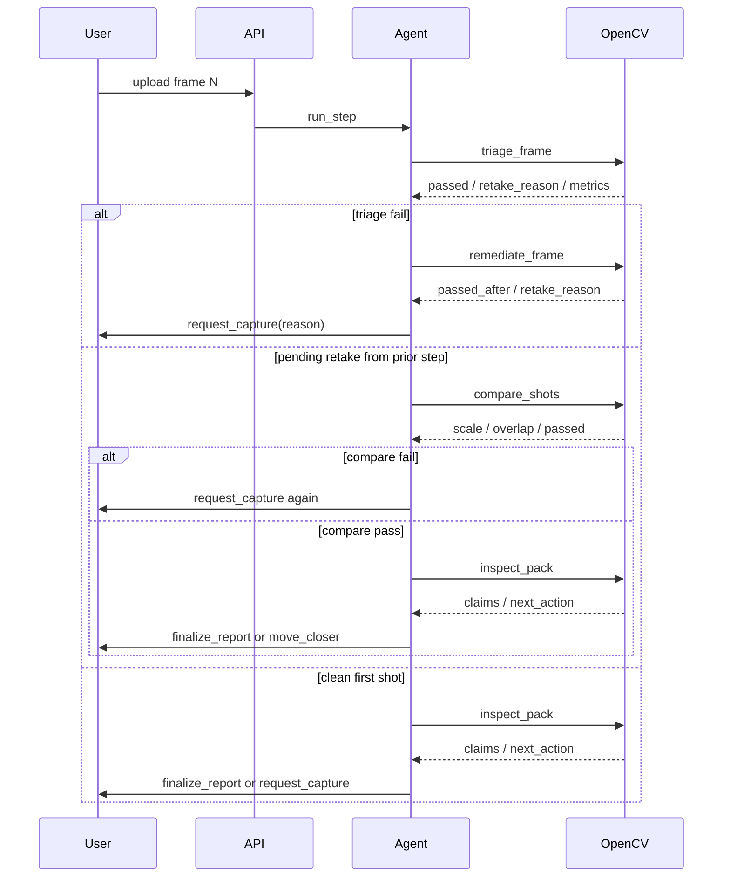

# Agentic extras — workflow + vision-driven traces

**Award fit:** Agentic Vision — OpenCV 5 tool results change the next plan/tool/action (not a chatbot over a fixed vision blob).

## Workflow (perception → decision → action)



## How to reproduce these traces

```bash
export LOOKAGAIN_AGENT=heuristic
uvicorn app.main:app --host 127.0.0.1 --port 8000
curl -s -F pair_id=leds_glare_retake -F pack_id=appliance_leds \
  http://127.0.0.1:8000/api/demo/run_pair | jq .
curl -s -F pair_id=leds_closer_retake -F pack_id=appliance_leds \
  http://127.0.0.1:8000/api/demo/run_pair | jq .
```

Fixtures: `app/static/fixtures/leds_glare_retake/` and `leds_closer_retake/`.  
Captured below with OpenCV **5.0.0**, heuristic agent (same tools Bedrock would call).

---

## Trace A — Glare / quality fail → retake → compare → finalize

`pair_id=leds_glare_retake` · `demo_ok=true`

### Step 1 (shot1 — washed glare)

| Tool | Vision signal that drove the next call | Next |
|------|----------------------------------------|------|
| `triage_frame` | `passed=false`, `glare_fraction≈0.34`, `fail_reasons=[glare, blur, exposure]`, preferred `retake_reason=less_glare` | remediate |
| `remediate_frame` | Glare inpaint helped (`glare_after≈0.009`) but `passed_after=false`, residual `retake_reason=blur` | request_capture |
| `request_capture` | Software recovery insufficient | **terminal** ask user for new photo |

Truncated step1 tools:

```json
{
  "next_action": "request_capture",
  "retake_reason": "blur",
  "agent": {
    "backend": "heuristic",
    "tools_called": ["triage_frame", "remediate_frame", "request_capture"]
  },
  "highlights": {
    "triage_glare_fraction": 0.338,
    "remediate_glare_after": 0.0087,
    "remediate_passed_after": false
  }
}
```

### Step 2 (shot2 — clean retake)

| Tool | Vision signal | Next |
|------|---------------|------|
| `triage_frame` | `passed=true`, sharpness ≫ threshold | compare (pending retake) |
| `compare_shots` | SIFT+USAC: `passed=true`, `scale≈1.00`, `overlap≈1.0`, `inliers=17` (same-distance quality retake) | inspect |
| `inspect_pack` | 1 green + 1 red LED blobs | finalize |
| `evidence_gate` | `allowed=true` | finalize_report |

```json
{
  "next_action": "finalize_report",
  "claims": [
    "Detected 1 green, 1 red indicator blob(s) matching pack color bands.",
    "Compare observed pattern to the appliance status legend; LookAgain does not assert device health."
  ],
  "agent": {
    "backend": "heuristic",
    "tools_called": [
      "triage_frame", "remediate_frame", "request_capture",
      "triage_frame", "compare_shots", "inspect_pack",
      "evidence_gate", "finalize_report"
    ]
  },
  "compare_shots": {
    "passed": true,
    "scale": 1.001,
    "overlap": 1.0,
    "inlier_count": 17,
    "matcher": "SIFT+USAC_MAGSAC"
  }
}
```

**Judge takeaway:** OpenCV triage/remediate metrics forced `request_capture`; OpenCV `compare_shots` gated whether the second photo was acceptable before inspect/finalize.

---

## Trace B — Inspector asks for closer → scale gate → finalize

`pair_id=leds_closer_retake` · `demo_ok=true`

### Step 1 (wide shot)

| Tool | Vision signal | Next |
|------|---------------|------|
| `triage_frame` | `passed=true` | inspect |
| `inspect_pack` | `led_count=0`, `next_action=request_capture` | request_capture(`move_closer`) |

```json
{
  "next_action": "request_capture",
  "retake_reason": "move_closer",
  "agent": {
    "tools_called": ["triage_frame", "inspect_pack", "request_capture"]
  },
  "inspect_pack": {
    "led_count": 0,
    "claims": [
      "No distinct colored LED blobs detected in view — retake closer to the indicator panel."
    ]
  }
}
```

### Step 2 (closer crop)

| Tool | Vision signal | Next |
|------|---------------|------|
| `triage_frame` | `passed=true` | compare |
| `compare_shots` | `scale≈1.82` (≥ 1.3 closer gate), `overlap≈0.89`, `inliers=114` | inspect |
| `inspect_pack` | `led_count=2` | finalize |

```json
{
  "next_action": "finalize_report",
  "compare_shots": {
    "passed": true,
    "scale": 1.818,
    "overlap": 0.889,
    "inlier_count": 114,
    "retake_reason": "move_closer",
    "matcher": "SIFT+USAC_MAGSAC"
  },
  "inspect_pack": {
    "led_count": 2,
    "color_counts": {"red": 1, "green": 1}
  }
}
```

**Judge takeaway:** Pack OpenCV output (`led_count=0`) changed the plan to `move_closer`; reason-aware `compare_shots` verified zoom before claims were allowed.

---

## Bedrock path

With `LOOKAGAIN_AGENT=auto` or `bedrock`, [`app/agent/bedrock_loop.py`](../../app/agent/bedrock_loop.py) uses the same tool specs/executors. The model must call tools one at a time; vision JSON in tool results is what should drive the next choice. Unit coverage: [`tests/test_bedrock_agent.py`](../../tests/test_bedrock_agent.py) (scripted Converse client). Heuristic traces above are the reproducible judge demo without AWS credentials.
