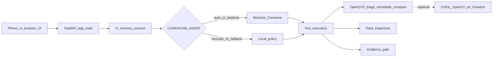
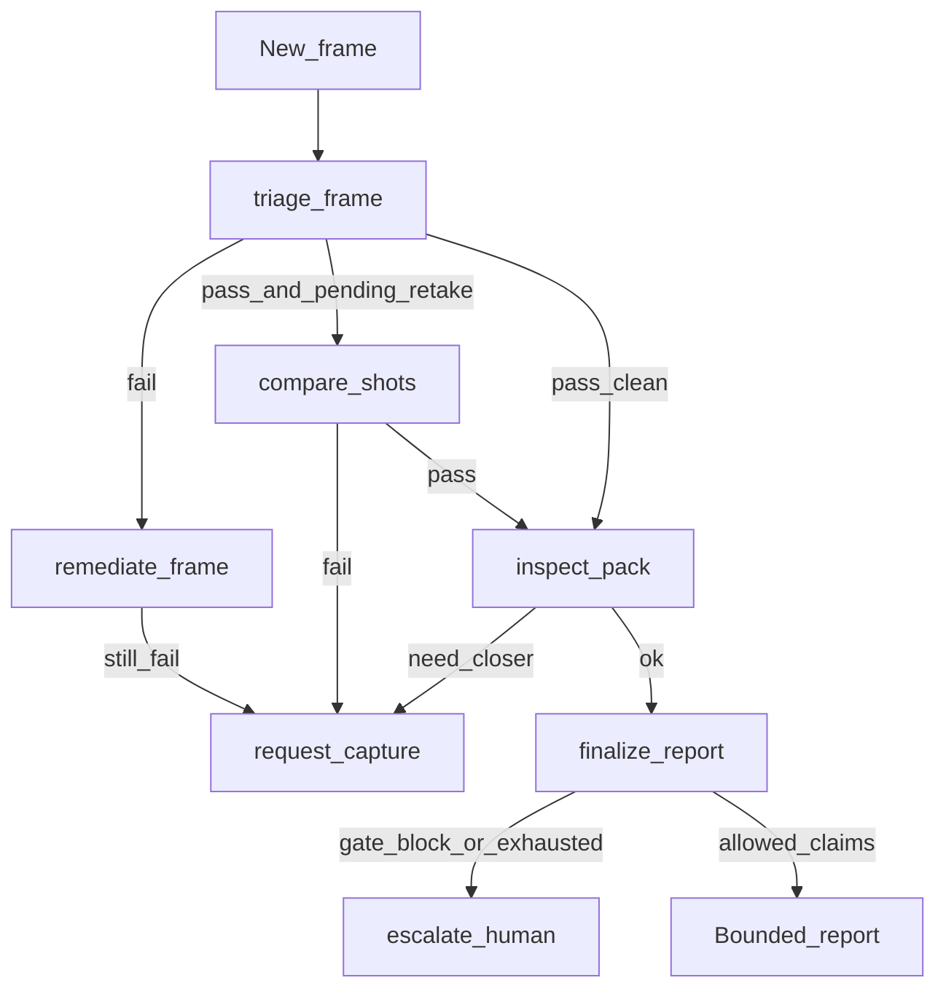
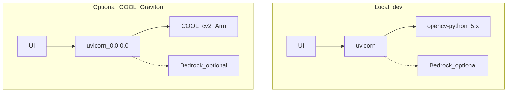

# Architecture

LookAgain is a phone-friendly FastAPI service. OpenCV 5 runs all vision tools locally. An agent (AWS Bedrock Converse, or a deterministic heuristic fallback) chooses the **next tool** from those metrics. Optional COOL on AWS Graviton can host the same OpenCV path.

## System context

### Components

| Layer | Location | Role |
|-------|----------|------|
| UI | [`app/static/index.html`](../../app/static/index.html) | Pack select, upload, no-prop demo pairs, tool-trace status |
| API | [`app/main.py`](../../app/main.py) | `/api/session/*`, `/api/upload`, `/api/demo/run_pair`, `/health` |
| Agent | [`app/agent/`](../../app/agent/) | Bedrock loop or heuristic; session retake state |
| Tools | [`app/agent/tools.py`](../../app/agent/tools.py) | Specs + executors for seven tools |
| Vision | [`app/vision/`](../../app/vision/) | Triage, remediate, SIFT+USAC `compare_shots`, evidence gate |
| Packs | [`app/vision/packs/`](../../app/vision/packs/) | `appliance_leds`, `bike_brake_pad`, `leaf_spot` |
| AWS | Bedrock Runtime | Claude (Haiku 4.5 inference profile by default) picks tools |
| COOL (optional) | Graviton AMI `/opt/cool` | Same app; OpenCV from COOL venv — see [COOL_EVIDENCE.md](COOL_EVIDENCE.md) |

## Agentic perception → decision → action

Vision metrics **must** change the next call. A chatbot that only narrates a fixed OpenCV result would not qualify; LookAgain routes on `passed`, `retake_reason`, `compare_shots.scale`, and pack `next_action`.

## Data flow for one upload step

1. Decode JPEG → BGR (`session.decode_image`).
2. Build `ToolContext` from session (prior shot, pending retake reason, retakes left).
3. Agent loop (max ~8 Bedrock turns) or heuristic policy calls tools until a terminal tool:
   - Terminal: `request_capture` | `finalize_report` | `escalate_human`
4. Persist retake state on the session for the next photo.
5. Return `next_action`, claims/reason, `agent.tools_called`, and full `trace`.

## Allowlists and gates

- **Pack allowlist** at session start: only three packs may proceed; others → `escalate_human`.
- **Evidence gate** before finalize: blocks “safe to ride”, disease names, medical diagnosis language ([`app/vision/evidence_gate.py`](../../app/vision/evidence_gate.py)).
- **Max retakes:** 3 (`MAX_RETAKES` in `compare_shots`).

## Deployment shapes

Pinned local deps: [`requirements.txt`](../../requirements.txt).  
COOL path deps (no pip OpenCV): [`requirements-cool.txt`](../../requirements-cool.txt).
